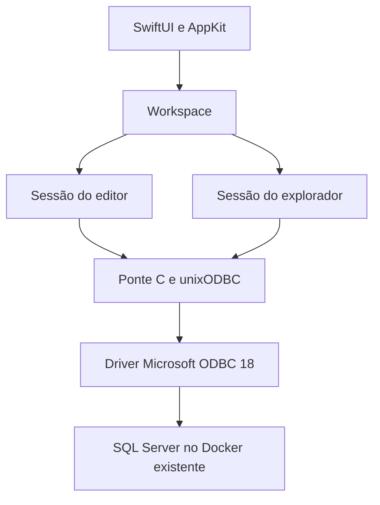

# Arquitetura da primeira versão

## Fluxo

`Workspace` concentra estado de interface no MainActor. `SQLClient` executa
operações ODBC numa DispatchQueue serial fora da interface. Há dois clientes:
editor e metadados. A sessão do editor é persistente e compartilhada entre
abas. A sessão de metadados consulta nomes qualificados por banco sem emitir
`USE` no editor.

`BatchParser` reconhece separadores GO fora de strings, comentários e
identificadores. Os lotes são enviados individualmente na mesma conexão.
O processamento para no primeiro erro e não repete nem faz retry automático.
Variáveis locais não atravessam GO; tabelas temporárias e transações da sessão
mantêm o comportamento do SQL Server.

## Ponte ODBC

`SQLBridge` carrega as funções necessárias de unixODBC com `dlopen`/`dlsym`.
A definição privada do subconjunto ABI usa inteiros de tamanho fixo e tipos
do tamanho do ponteiro para SQLLEN/SQLULEN, destinados a plataformas de 64 bits.
O cabeçalho público expõe somente uma sessão opaca e strings UTF-8/JSON.
Isso evita caminhos de headers e linkagem do Homebrew no projeto Swift.

`SQLExecDirect`, `SQLFetch`, `SQLGetData` e `SQLMoreResults` preservam conjuntos
múltiplos, DML sem tabela, mensagens e erros. Resultados parciais são devolvidos
junto ao erro. NULL permanece null no JSON. Binários viram hexadecimal.
A leitura de texto ocorre em blocos; os limites de exibição são explícitos.
Nenhuma camada modifica o SQL para adicionar filtros ou limites.

O bridge controla a vida útil do statement com mutex para permitir SQLCancel
em outra thread sem liberar o handle durante a chamada. Cancelar é best effort,
com timeout de statement como proteção adicional. Nenhum retry automático evita
a duplicação de INSERT/UPDATE após uma falha ambígua de rede.

## Interface

- SwiftUI: janela, barra lateral, abas, formulários e painéis.
- NSTextView: editor de código, seleção, undo e destaque visual básico.
- NSTableView: grade de resultados com colunas dinâmicas e seleção de linhas.
- NSOpenPanel/NSSavePanel: abrir/salvar SQL e CSV.
- Keychain Services: credenciais opcionais.
- UserDefaults: perfil sem senha.

O cliente atual usa autenticação SQL Server com TCP explícito. O app criptografa
a conexão; confiar em certificado próprio é uma escolha visível do perfil.
Os campos de conexão são delimitados conforme a sintaxe ODBC, e identificadores
usados pelo explorador são escapados. O SQL escrito pelo usuário é executado
literalmente, com seus privilégios no SQL Server.

## Docker

`DockerService` chama o executável Docker com uma lista de argumentos, sem
shell. Lista containers existentes e permite start/stop por nome validado.
Não cria ou remove containers/volumes e não usa docker inspect para expor
variáveis de ambiente ou senhas. Uma porta não é inferida pelo nome do container;
o usuário continua configurando o endpoint da conexão.

Ao parar um container selecionado, as sessões do app são desconectadas primeiro.
É possível que outros aplicativos ainda estejam conectados ao mesmo servidor;
o texto da interface explica que parar o servidor encerra conexões com ele.

## Fora do escopo inicial

Editor Python, console Python, chat de IA, sincronização em nuvem, telemetria,
instalador de SQL Server, novos containers automáticos, edição inline, designers
de schema, ERD e equivalência completa com SSMS não fazem parte desta entrega.

## Próximas melhorias após validar

1. Medir consumo de memória e reduzir cópias de resultados grandes.
2. Salvar/restaurar o workspace e permitir uma conexão por aba.
3. Acrescentar autocompletar e números de linha com um editor nativo adequado.
4. Assinatura Developer ID/notarização apenas se for distribuir publicamente.

Primeiro compilar, testar e estabilizar o fluxo existente no Mac do usuário.

## Ajustes confirmados no macOS em 19/10/2026

`SQLClient` inicializa `LC_CTYPE` em `en_US.UTF-8` antes da primeira conexão,
uma única vez para ambas as sessões. Isso corrigiu o tráfego Unicode observado
com o driver real, sem alterar locale numérico, idioma ou preferências do Mac.

O pacote `.app` tem `SQLGardenLauncher` como entrada nativa. Ele escolhe o
caminho Homebrew versionado `openssl@3/lib` no `DYLD_LIBRARY_PATH` do próprio
processo e faz `exec` do executável Swift `SQLGarden`, preservando argumentos.
O build assina o executável Swift e o bundle. Não há alteração dos symlinks de
OpenSSL do sistema nem cópia de bibliotecas de terceiros para o pacote.
O ajuste é necessário porque ODBC 18.7.1.1 não carregou OpenSSL 4 neste Mac.

`CopyTableView` implementa o seletor AppKit `copy:` para o menu de edição e ⌘C;
o atalho é resolvido pelo responder chain antes de `keyDown`.

A opção explícita de provisionamento local apenas conecta o primeiro perfil
fixo à instância recém-instalada, recebendo sua senha por variável de ambiente.
Ela é ignorada quando já há um perfil. O app cria seu próprio item no Chaves,
evita problemas de autorização entre um utilitário externo e um bundle ad hoc
e remove a variável do ambiente C após lê-la. Não é uma conexão automática
nas aberturas seguintes, nem um instalador de Docker/SQL Server.
